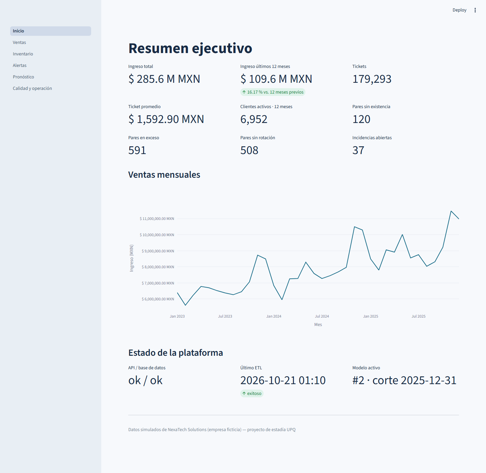

# DATACORE

[](https://github.com/davidatilano18/DATACORE/actions/workflows/ci.yml)

**Plataforma Inteligente de Gestión, Monitoreo y Análisis de Datos Empresariales**

Proyecto de estadía de la Universidad Politécnica de Querétaro, Ingeniería en Datos e Inteligencia Artificial.
Integrantes: David Israel Atilano Quiroz y Ricardo Leonel Ordaz Aguilar.

DATACORE centraliza, limpia, valida y analiza la información de **NexaTech Solutions S.A. de C.V.**,
una distribuidora ficticia con 12 sucursales, y pronostica la demanda para anticipar desabastos y excesos de inventario.

## Inicio rápido

```powershell
python -m venv .venv
.venv\Scripts\python -m pip install --only-binary=:all: -r requirements.txt
.venv\Scripts\python -m pip install -e .

# Genera unos 3 años de operación simulada en data/ (alrededor de 15 s)
.venv\Scripts\python -m datacore.generator --salida data

# Base de datos: copia .env.example a .env, llena las contraseñas y crea BD, roles y tablas
.venv\Scripts\python -m datacore.db_setup

# ETL: data/raw → PostgreSQL, con evaluación de calidad (alrededor de 50 s)
.venv\Scripts\python -m datacore.etl --evaluar

# Análisis exploratorio → reports/eda/
.venv\Scripts\python -m datacore.eda.reporte

# Pronóstico: evaluar contra baselines y publicar pronósticos y alertas en ops
.venv\Scripts\python -m datacore.ml evaluar
.venv\Scripts\python -m datacore.ml publicar

# Servicios: API (http://127.0.0.1:8000/docs) y dashboard (http://localhost:8501)
.venv\Scripts\python -m uvicorn datacore.api.app:app --port 8000
.venv\Scripts\python -m streamlit run src/datacore/dashboard/Inicio.py

# Operación: respaldo verificado, monitoreo y proceso diario completo
.venv\Scripts\python -m datacore.operacion respaldo --verificar
.venv\Scripts\python -m datacore.operacion monitoreo
.venv\Scripts\python -m datacore.operacion diario

# Pruebas
.venv\Scripts\python -m pytest -q
```

Guía completa: [manual técnico](docs/manual_tecnico.md).

## Estado

| Etapa (semanas) | Componente | Estado |
|---|---|---|
| 1–2 | Requerimientos y alcance: [docs/01](docs/01_requerimientos.md) | Borrador |
| 3–4 | Arquitectura, modelo entidad-relación, diccionario de datos: [docs/02](docs/02_arquitectura.md), [docs/03](docs/03_modelo_datos.md), [db/schema.sql](db/schema.sql) | Borrador |
| 5–6 | Generador de datos: [docs/04](docs/04_simulacion.md) | Listo |
| 5–6 | Base de datos y ETL con bitácora en `ops`: [reports/etl/calidad.md](reports/etl/calidad.md) | Listo |
| 7–8 | Reglas de calidad (18/18 defectos, precisión 100 %) | Listo |
| 7–8 | Análisis exploratorio: [reports/eda](reports/eda/README.md) | Primera versión |
| 7–8 | Indicadores: esquema `kpi` con 9 vistas ([db/vistas.sql](db/vistas.sql)) | Listo |
| 9–10 | Pronóstico de demanda semanal y alertas: [docs/05](docs/05_modelo_demanda.md), [reports/ml](reports/ml/backtest.md) | Listo |
| 11–12 | API REST (FastAPI, `/docs`) y dashboard (Streamlit, 6 páginas) | Listo |
| 13–14 | Respaldos verificados, monitoreo, proceso diario, CI y Docker: [docs/06](docs/06_operacion_y_despliegue.md) | Listo |
| 13–14 | Despliegue en servidor (Railway o VPS) | Pendiente: decisión del equipo |
| 15–16 | [Manual técnico](docs/manual_tecnico.md) y [manual de usuario](docs/manual_usuario.md) | Primera versión |
| 15–16 | Memoria de estadía | Pendiente |

## Datos generados

- `data/raw/`: lo que "envía" cada área: CSV del POS por año, Excel de compras, CSV del CRM en Windows-1252, movimientos de almacén e incidencias. **Trae defectos a propósito.**
- `data/ground_truth/`: versión limpia de referencia, bitácora de defectos inyectados y datos ocultos (demanda perdida, órdenes de compra).

## Dashboard

Con la API en ejecución:

```powershell
.venv\Scripts\python -m streamlit run src/datacore/dashboard/Inicio.py
```



Capturas de todas las páginas en [`reports/dashboard/`](reports/dashboard/) (se regeneran con
`python scripts/capturas_dashboard.py` con la API y el dashboard corriendo).

El dashboard consume únicamente la API. Configura `DATACORE_API_URL` (por defecto
`http://127.0.0.1:8000`) y, si el servicio exige autenticación, `DATACORE_API_KEY`
en el entorno del proceso. Las lecturas se conservan en caché durante cinco minutos.

- **Inicio:** indicadores ejecutivos, ventas mensuales y salud de la plataforma.
- **Ventas:** fechas y sucursal, serie diaria, media móvil, categorías y clasificación ABC histórica.
- **Inventario:** estados, cobertura por sucursal y tasa mensual de desabasto.
- **Alertas:** pendientes por tipo y sucursal, con acción para marcarlas como atendidas.
- **Pronóstico:** búsqueda por nombre/SKU, historia de 52 semanas, cuatro semanas previstas e indicadores del modelo.
- **Calidad y operación:** hallazgos por regla y acción, ejecuciones del ETL e incidencias mensuales.
