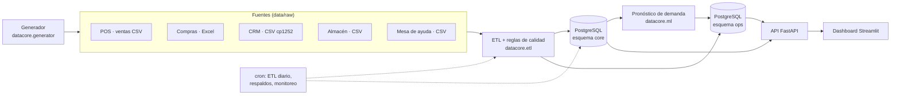

# 02 · Arquitectura

## Vista general



## Capas y tecnologías

| Capa | Función | Tecnología elegida | Alternativa de la propuesta |
|---|---|---|---|
| Fuentes | Archivos simulados por área | Python (numpy, pandas, Faker) | — |
| Procesamiento | Extracción, limpieza, validación, carga | Python + pandas | — |
| Persistencia | Almacenamiento relacional | **PostgreSQL 16** | MySQL |
| Analítica e IA | EDA, entrenamiento, evaluación, predicción | scikit-learn, numpy, pandas | — |
| Servicios | API entre la BD, el modelo y la interfaz | **FastAPI** | Flask |
| Visualización | Indicadores, alertas, tendencias | **Streamlit** | Power BI |
| Infraestructura | Ejecución, monitoreo, respaldos | Linux, cron, Git, VPS | — |

**Por qué esta combinación:** todo es Python y open source, así que un solo lenguaje cubre del generador al dashboard. Streamlit puede consumir la API o leer directamente las vistas de la BD. PostgreSQL aporta esquemas, `JSONB` para métricas de modelos y `pg_dump` para los respaldos.

## Estructura del repositorio

```
DATACORE/
├── AGENTS.md            Guía para agentes de código (Codex, Claude)
├── README.md
├── pyproject.toml       Paquete instalable (pip install -e .)
├── requirements.txt
├── db/
│   └── schema.sql       DDL de PostgreSQL (esquemas core y ops)
├── docs/                Documentación del proyecto (entregables)
├── src/datacore/
│   ├── generator/       Generador de datos simulados   ← listo
│   ├── etl/             Extracción, limpieza, calidad, carga  ← siguiente
│   ├── ml/              Pronóstico y alertas
│   ├── api/             FastAPI
│   └── dashboard/       Streamlit
├── tests/               pytest
└── data/                Generado; no se versiona
    ├── raw/             Lo que "envían" las áreas (con defectos)
    └── ground_truth/    Datos limpios de referencia y bitácora de defectos
```

## Decisiones

| # | Decisión | Motivo |
|---|---|---|
| D-01 | Los archivos crudos usan códigos de negocio (código de sucursal, SKU), no llaves internas. | Así exporta un sistema real; obliga al ETL a resolver llaves. |
| D-02 | El generador guarda una "verdad de referencia" limpia (`ground_truth/`). | Permite medir objetivamente el ETL y las reglas de calidad. |
| D-03 | Las ventas se recortan según la existencia disponible. | La demanda no surtida no aparece en las ventas, como en la realidad. El modelo trabaja con demanda censurada. |
| D-04 | Python 3.15 con entorno virtual en `.venv`. | Es la versión instalada; todas las dependencias tienen ruedas (wheels). |
| D-05 | Sin Docker por ahora; PostgreSQL se instalará nativo o en el servidor. | Docker no está instalado en el equipo de desarrollo. |
| D-06 | Los datos no se versionan en Git; se regeneran. | Pesan unos 80 MB y se reproducen en unos 15 s con la misma semilla. |
