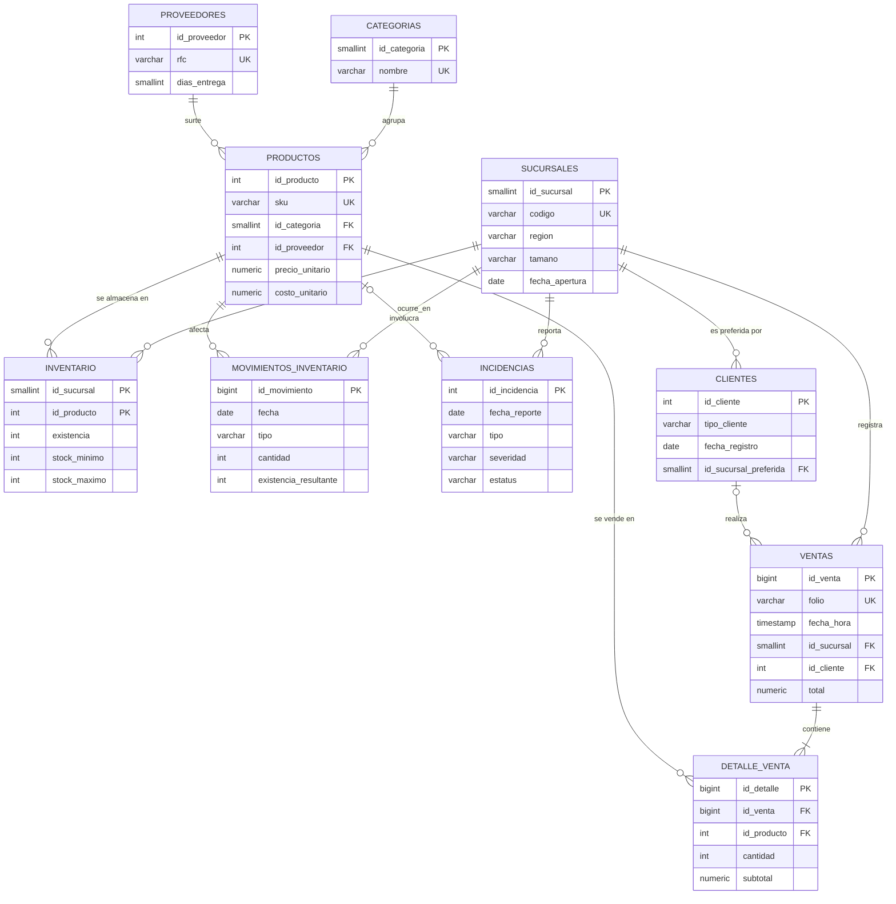
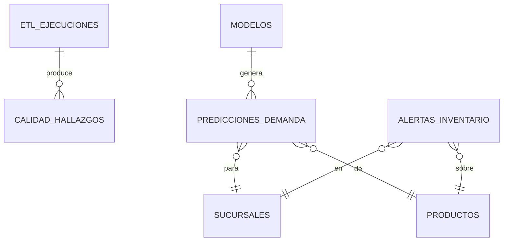

# 03 · Modelo entidad-relación y diccionario de datos

El DDL completo está en [`db/schema.sql`](../db/schema.sql). Hay dos esquemas:

- **`core`**: datos de negocio ya validados.
- **`ops`**: operación de la plataforma (ETL, calidad, modelos, predicciones, alertas).

## Diagrama entidad-relación (`core`)

## Diagrama entidad-relación (`ops`)

## Diccionario de datos

Convenciones: las llaves primarias se llaman `id_<entidad>`, los nombres van en español sin acentos y en `snake_case`, los montos en pesos mexicanos (MXN) con `NUMERIC(…,2)`, y las fechas sin zona horaria (hora local del Centro de México).

### core.sucursales (12 filas)

| Columna | Tipo | Nulo | Descripción |
|---|---|---|---|
| id_sucursal | SMALLINT | No | Llave primaria. |
| codigo | VARCHAR(10) | No | Código de negocio único (`QRO01`, `CDMX02`…). Es el que usan los archivos crudos. |
| nombre | VARCHAR(80) | No | Nombre comercial. |
| ciudad, estado | VARCHAR | No | Ubicación. |
| region | VARCHAR(20) | No | Bajío, Centro, Occidente o Norte. |
| tamano | VARCHAR(10) | No | `grande`, `mediana` o `pequena`; determina la afluencia. |
| fecha_apertura | DATE | No | Dos sucursales abren dentro del periodo (QRO03 en abril de 2024 y MOR01 en septiembre de 2024). |

### core.categorias (10 filas)

| Columna | Tipo | Nulo | Descripción |
|---|---|---|---|
| id_categoria | SMALLINT | No | Llave primaria. |
| nombre | VARCHAR(40) | No | Abarrotes, Bebidas, Limpieza, Cuidado personal, Electrónica, Papelería, Juguetes, Hogar, Mascotas, Dulcería y botanas. |

### core.proveedores (35 filas)

| Columna | Tipo | Nulo | Descripción |
|---|---|---|---|
| id_proveedor | INTEGER | No | Llave primaria. |
| nombre | VARCHAR(120) | No | Razón social. |
| rfc | VARCHAR(13) | No | RFC de persona moral (ficticio). |
| ciudad, estado, telefono, email | VARCHAR | Sí | Contacto. |
| dias_entrega | SMALLINT | No | Tiempo de entrega comprometido, de 2 a 10 días. |
| activo | BOOLEAN | No | Proveedor vigente. |

### core.productos (400 filas)

| Columna | Tipo | Nulo | Descripción |
|---|---|---|---|
| id_producto | INTEGER | No | Llave primaria. |
| sku | VARCHAR(20) | No | Código único `NX-<CAT>-<nnnnn>`. Es el que usan los archivos crudos. |
| nombre | VARCHAR(120) | No | Artículo + marca ficticia + presentación. |
| id_categoria | SMALLINT | No | FK a categorías. En el Excel crudo viene el **nombre** de la categoría. |
| id_proveedor | INTEGER | No | FK a proveedores. |
| precio_unitario | NUMERIC(10,2) | No | Precio de lista vigente (2025). Los precios históricos están en `detalle_venta`. |
| costo_unitario | NUMERIC(10,2) | No | Costo de adquisición; debe ser menor que el precio. |
| unidad | VARCHAR(10) | No | Unidad de venta (`pieza`). |
| fecha_alta | DATE | No | Inicio de comercialización. Unos 8 % de los productos se lanzan dentro del periodo. |
| activo | BOOLEAN | No | `false` si se descontinuó (unos 5 %). |

### core.clientes (8,000 filas)

| Columna | Tipo | Nulo | Descripción |
|---|---|---|---|
| id_cliente | INTEGER | No | Llave primaria. |
| nombre, apellido_paterno, apellido_materno | VARCHAR | No / No / Sí | Nombre completo (ficticio). |
| email | VARCHAR(120) | Sí | Correo electrónico. |
| telefono | VARCHAR(15) | Sí | 10 dígitos con lada de su ciudad. |
| ciudad, estado | VARCHAR | Sí | Domicilio (el de su sucursal preferida). |
| tipo_cliente | VARCHAR(10) | No | `minorista` (90 %) o `mayorista` (10 %; compra más renglones y volumen). |
| fecha_registro | DATE | No | Alta en el CRM; siempre anterior a su primera compra. |
| id_sucursal_preferida | SMALLINT | Sí | FK a sucursales; hace ahí alrededor del 90 % de sus compras. |

### core.ventas (unas 181 mil filas)

| Columna | Tipo | Nulo | Descripción |
|---|---|---|---|
| id_venta | BIGINT | No | Llave primaria. |
| folio | VARCHAR(20) | No | `<codigo_sucursal>-<consecutivo>`, único. |
| fecha_hora | TIMESTAMP | No | Momento del ticket (de 9:00 a 21:00). |
| id_sucursal | SMALLINT | No | FK a sucursales. |
| id_cliente | INTEGER | Sí | FK a clientes; `NULL` = venta a público general (unos 30 %). |
| metodo_pago | VARCHAR(20) | Sí | `efectivo`, `tarjeta_debito`, `tarjeta_credito` o `transferencia`. |
| total | NUMERIC(12,2) | No | Suma de los `subtotal` del detalle. |
| estatus | VARCHAR(12) | No | `completada` o `cancelada` (alrededor del 1 %; no descuenta inventario). |

### core.detalle_venta (unas 641 mil filas)

| Columna | Tipo | Nulo | Descripción |
|---|---|---|---|
| id_detalle | BIGINT | No | Llave primaria. |
| id_venta | BIGINT | No | FK a ventas. Un producto aparece una sola vez por ticket. |
| id_producto | INTEGER | No | FK a productos. En el CSV crudo viene el **SKU**. |
| cantidad | INTEGER | No | Unidades, mayor que 0. |
| precio_unitario | NUMERIC(10,2) | No | Precio de lista del año de la venta (se actualiza cada enero, con inflación de alrededor del 5 %). |
| descuento_pct | NUMERIC(4,3) | No | 0.05 para mayoristas; de 0.10 a 0.25 en Buen Fin para Electrónica, Juguetes y Hogar. |
| subtotal | NUMERIC(12,2) | No | `cantidad × precio_unitario × (1 − descuento_pct)`. |

### core.inventario (4,800 filas)

Foto de la existencia al cierre del periodo, por sucursal y producto.

| Columna | Tipo | Nulo | Descripción |
|---|---|---|---|
| id_sucursal, id_producto | — | No | Llave primaria compuesta. |
| existencia | INTEGER | No | Unidades disponibles (≥ 0). |
| stock_minimo | INTEGER | No | Punto de reorden vigente. |
| stock_maximo | INTEGER | No | Nivel objetivo al resurtir. |
| fecha_actualizacion | DATE | No | Fecha de la foto. |

### core.movimientos_inventario (unas 648 mil filas)

| Columna | Tipo | Nulo | Descripción |
|---|---|---|---|
| id_movimiento | BIGINT | No | Llave primaria; respeta el orden cronológico. |
| fecha | DATE | No | Día del movimiento. |
| id_sucursal, id_producto | — | No | FK. En el CSV crudo vienen el código de sucursal y el SKU. |
| tipo | VARCHAR(20) | No | `INVENTARIO_INICIAL`, `ENTRADA_COMPRA`, `SALIDA_VENTA` (consolidado diario), `MERMA` o `AJUSTE_CONTEO`. |
| cantidad | INTEGER | No | Con signo: **+ entra, − sale**. |
| existencia_resultante | INTEGER | No | Existencia después del movimiento. La suma acumulada de `cantidad` debe dar este valor. |
| referencia | VARCHAR(20) | Sí | Orden de compra (`OC-…`) en las entradas. |

### core.incidencias (unas 6,700 filas)

| Columna | Tipo | Nulo | Descripción |
|---|---|---|---|
| id_incidencia | INTEGER | No | Llave primaria. |
| fecha_reporte | DATE | No | Fecha de reporte. |
| id_sucursal | SMALLINT | No | FK. |
| id_producto | INTEGER | Sí | FK cuando aplica (desabasto, retraso, merma, diferencia). |
| tipo | VARCHAR(25) | No | `FALLA_SISTEMA`, `DESABASTO`, `RETRASO_PROVEEDOR`, `MERCANCIA_DANADA`, `DIFERENCIA_INVENTARIO` o `QUEJA_CLIENTE`. |
| severidad | VARCHAR(5) | No | `baja`, `media` o `alta`. |
| descripcion | VARCHAR(250) | No | Texto libre. |
| estatus | VARCHAR(12) | No | `abierta`, `en_proceso` o `resuelta`. |
| fecha_resolucion | DATE | Sí | Solo si está resuelta. |

### Esquema ops

| Tabla | Propósito |
|---|---|
| `etl_ejecuciones` | Una fila por proceso ETL ejecutado: archivo, duración, filas leídas, cargadas y rechazadas, error. |
| `calidad_hallazgos` | Una fila por registro afectado por una regla de calidad: regla, severidad, acción (`corregido`, `rechazado`, `marcado`), valores antes y después. |
| `modelos` | Versiones de modelos entrenados con sus métricas (`JSONB`) y la marca de cuál está activo. |
| `predicciones_demanda` | Pronóstico semanal por sucursal y producto, con intervalo. |
| `alertas_inventario` | Alertas `RIESGO_DESABASTO`, `EXCESO_INVENTARIO` y `SIN_ROTACION`, con su cobertura en días. |
