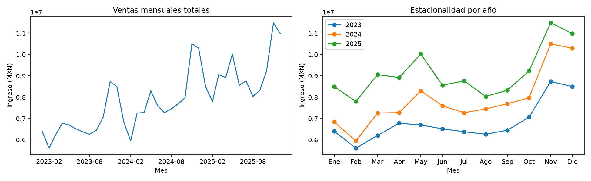
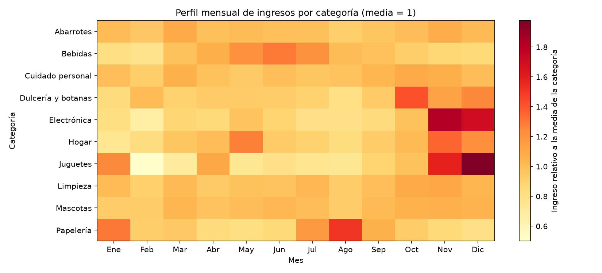
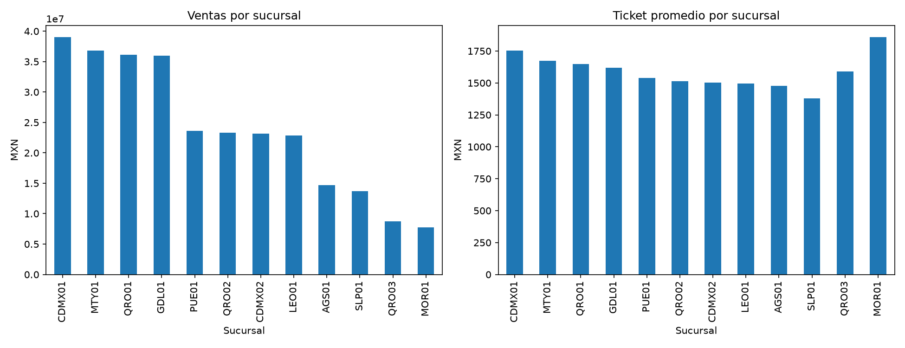
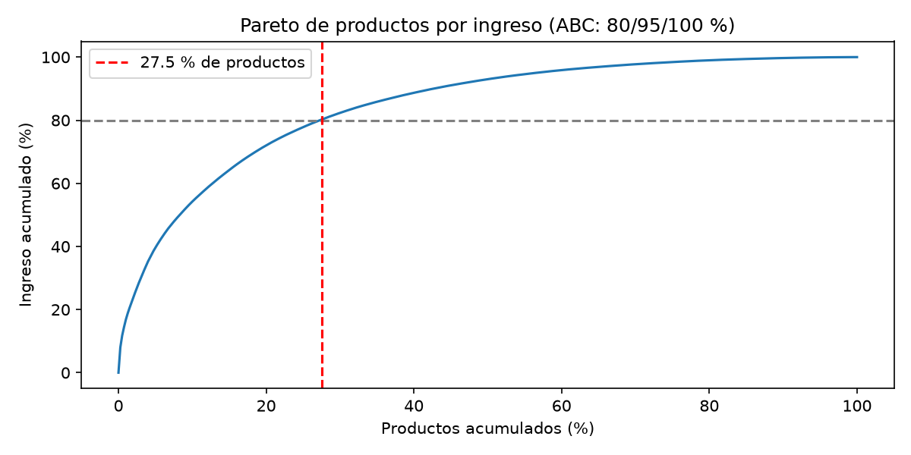
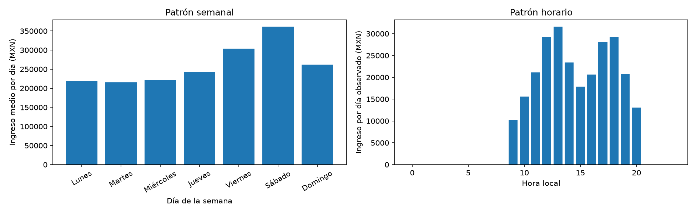
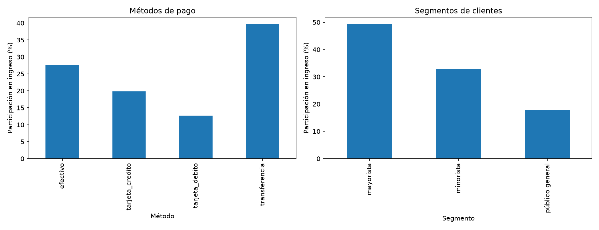
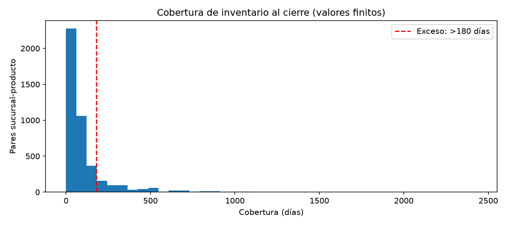
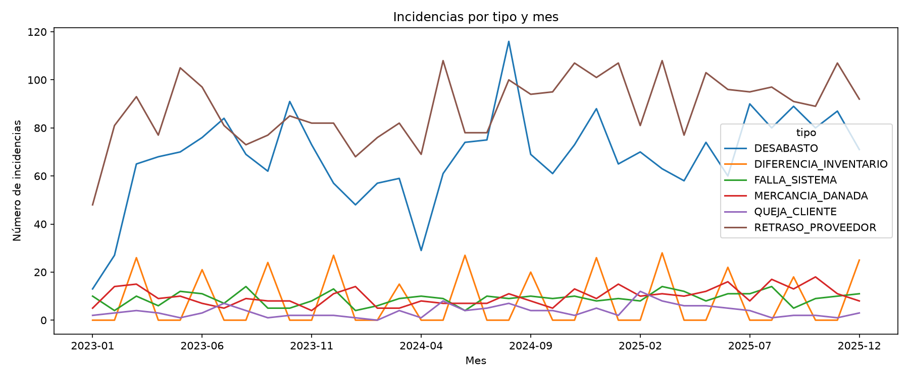

# EDA de DATACORE — NexaTech Solutions

Periodo: 2023-01-01 a 2025-12-31. Se analizan 179,302 ventas completadas por 285,719,932.57 MXN; se excluyen 1,752 canceladas de todos los indicadores de venta. Fuentes: únicamente las diez tablas core; no se leen tablas ocultas. Los montos históricos usan total del ticket o subtotal del detalle, sin duplicar tickets en las uniones.

## Ventas mensuales

El máximo mensual fue 2025-11: 11,488,900.61 MXN; el mínimo fue 2023-02: 5,609,560.58 MXN.

## Categorias mes

El mayor índice estacional es Juguetes en Dic: 1.98 veces su media mensual (1,258,174.68 MXN). Se promedian los años disponibles por mes.

## Sucursales

CDMX01 encabeza el ingreso con 39,022,046.64 MXN (13.7%); su ticket promedio es 1,755.14 MXN. Los totales no ajustan por antigüedad de apertura.

## Pareto productos

110 de 400 productos (27.5 %) generan 80.2 % del ingreso. ABC incluye el producto que cruza cada umbral; el detalle está en [abc_productos.csv](abc_productos.csv).

## Calendario

Sábado tiene el mayor ingreso diario medio: 361,079.80 MXN; la hora pico es 13:00 con 31,584.99 MXN por día. Se incluyen días sin ventas; no se ajusta por sucursales activas.

## Mezcla

Por ingreso en MXN, pagos: efectivo: 27.7 %; tarjeta_credito: 19.9 %; tarjeta_debito: 12.7 %; transferencia: 39.7 %. Segmentos: mayorista: 49.4 %; minorista: 32.9 %; público general: 17.7 %.

## Inventario

Al 2025-12-31, 1098 de 4800 pares tienen cobertura >180 días, incluidos 506 con stock y sin ventas en 90 días; 120 tienen existencia cero. Mediana finita: 57.0 días. Cobertura = existencia / (unidades vendidas en los últimos 90 días / 90), incluyendo ceros diarios. Stock cero se representa con cobertura cero; stock positivo sin ventas, con infinito (fuera del histograma). Lista completa: [alertas_inventario.csv](alertas_inventario.csv); todos los pares: [cobertura_inventario.csv](cobertura_inventario.csv).

## Incidencias

RETRASO_PROVEEDOR concentra 3,180 de 6,720 incidencias; su pico es 2024-05 con 108.

## Implicaciones para el modelo de demanda

- Incorporar mes, día semanal, hora, quincena y eventos comerciales; validar con cortes temporales. El ingreso combina unidades, precios y descuentos: pronosticar unidades semanales por par y usar el ingreso como diagnóstico.
- Intermitencia: 88.7% de los días-par observables de productos activos al cierre no tienen venta. El denominador comienza en el máximo entre apertura, alta e inicio del periodo e incluye pares sin ventas; comparar métodos para series intermitentes y medir error agregado y por segmento ABC.
- Hay 44 productos dados de alta dentro del periodo y 20 inactivos al cierre. No interpretar días previos al alta como demanda cero; usar categoría y atributos para arranque. La fecha de descontinuación no está en core, por lo que no puede reconstruirse la vigencia final exacta.
- Aperturas dentro del periodo: 2 (QRO03, MOR01). Modelar antigüedad y maduración; comparar tasas por día operativo además de ventas totales.
- Las ventas observadas están censuradas por disponibilidad. Existencia cero al cierre no demuestra desabasto durante todo el periodo; contrastar movimientos e incidencias sin atribuir los ceros automáticamente a falta de demanda. No se consultan tablas ocultas ni se estima aquí demanda perdida.
